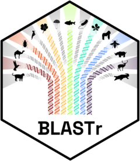

# BLASTr: Parallel Taxonomic Classification of Metabarcoding Sequences <a href="https://heronoh.github.io/BLASTr/"></a>

<!-- README.md is generated from README.Rmd. Please edit that file -->

<!-- badges: start -->

[](https://github.com/heronoh/BLASTr/actions/workflows/r-cmd-check.yaml)
<!-- [](https://CRAN.R-project.org/package=BLASTr) -->
<!-- badges: end -->

## Overview

`BLASTr` is an R package that seamlessly integrates BLAST+ searches into
your R workflow. It is specifically designed for the analysis of
amplicon sequences from metabarcoding and metagenomic studies. With
`BLASTr`, you can efficiently perform taxonomic classification of your
sequences by leveraging the power of parallel processing and automated
dependency management.

## Features

- **Parallel BLAST Searches:** Sequences are searched in batches, with
  the number of processes and threads chosen from your cores, RAM and
  database size. Searches can run in the background, with progress and
  ETA.
- **Automated Dependency Management:** `BLASTr` automatically installs
  and manages BLAST+ using `condathis`, ensuring a hassle-free setup.
- **Reference Databases:** Download any BLAST database of the NCBI
  (e.g. `core_nt`), or UNITE and SILVA formatted with NCBI taxids, ready
  for `parallel_blast()`.
- **Taxonomic Classification:** Retrieve detailed taxonomic information
  for your sequences using their NCBI Taxonomy IDs.
- **Flexible and Easy to Use:** The package provides a set of intuitive
  functions that simplify the process of running thousands of BLAST
  searches and handling the results.
- **Reproducible Research:** By managing dependencies in isolated Conda
  environments, `BLASTr` helps ensure that your analyses are
  reproducible.

## Installation

You can install the development version of `BLASTr` from GitHub with:

``` r
# install.packages("devtools")
devtools::install_github("heronoh/BLASTr")
```

## Basic Usage

Here’s a simple example of how to use `BLASTr` to perform a BLAST search
and retrieve taxonomic information:

## Reference databases

`download_blast_db()` downloads any BLAST database the NCBI publishes
(see `list_ncbi_blast_dbs()` for their sizes and dates), checks the md5
of each file and unpacks it into a directory named after the database
and its date, so a new release does not overwrite the one older results
were searched against. An interrupted download resumes where it stopped.
By default it also downloads `taxdb` and builds the taxonomy database of
`get_tax()` for the same date.

`make_unite_db()` and `make_silva_db()` download UNITE (ITS, all
eukaryotes or only fungi) and SILVA (SSU Ref NR99, 16S/18S) and format
them as BLAST databases with NCBI taxids, so `get_tax()`, `blast_lca()`
and the summaries work as with the NCBI databases. The UNITE or SILVA
classification goes to the subject header. UNITE has no NCBI taxids:
each sequence gets the taxid of the deepest name of its classification
found in the NCBI taxonomy (in the release of 2026-11-20, 98% of the
sequences named to species got the taxid of the species). SILVA gives
the NCBI taxid of each record. A table next to each database records the
taxid of each sequence and how it was found. Both are licensed under CC
BY 4.0: cite the release (the DOI is kept next to the database).

``` r
list_ncbi_blast_dbs()

# about 300 GB unpacked; use a disk with room for it
core_nt <- download_blast_db("core_nt", dir = "/data/databases")

its <- make_unite_db("/data/databases", set = "eukaryotes")
ssu <- make_silva_db("/data/databases")

blast_results <- parallel_blast(seqs, db_path = its, total_cores = 8)
```

## Making local custom databeses

You can turn any *.fasta* file with unique headers into a BLAST+
formated database using the BLASTr function *make_blast_db*. It is
recomended that the unique identifier of each sequence do not contain
*.*. You may provide a *.txt* with the same name as the DB’s *.fasta*
file, formated *lcl\|*<SequenceId> <TaxonomyId><newline>.

If you want to retrieve *subject Scientific name* on the results, BLAST
needs the *taxdb* files of the NCBI (`download_blast_db("taxdb", ...)`,
or with any database by `download_blast_db()`).

``` r
library(BLASTr)

# First, make sure you have the necessary dependencies installed
install_dependencies()

# A vector of query sequences
seqs <- c(
  "CTAGCCATAAACTTAAATGAAGCTATACTAAACTCGTTCGCCAGAGTACTACAAGCGAAAGCTTAAAACTCATAGGACTTGGCGGTGTTTCAGACCCAC",
  "CTAGCCATAAACTTAAATGAAGCTATACTAAACTCGTTCGCCAGAGTACTACAAGTGAAAGCTTAAAACTCATAGGACTTGGCGGTGTTTCAGACCCAC",
  "GCCAAATTTGTGTTTTGTCCTTCGTTTTTAGTTAATTGTTACTGGCAAATGACTAACGACAAATGATAAATTACTAATAC",
  "AACATTGTATTTTGTCTTTGGGGCCTGGGCAGGTGCAGTAGGAACTTCACTTAGAATAATTATTCGTACTGAGCTTGGGCATCCAGGAAGACTTATCGGGGATGATCAAATCTATAATGTAATTGTTACAGCACATGCATTTGTGATAATTTTTTTTATAGTAATACCTATTATGATT",
  "ACTATACCTATTATTCGGCGCATGAGCTGGAGTCCTAGGCACAGCTCTAAGCCTCCTTATTCGAGCCGAGCTGGGCCAGCCAGGCAACCTTCTAGGTAACGACCACATCTACAACGTTATCGTCACAGCCCATGCATTTGTAATAATCTTCTTCATAGTAATACCCATCATAATCGGAGGCTTTGGCAACTGACTAGTTCCCCTAATAATCGGTGCCCCCGATATG",
  "TTAGCCATAAACATAAAAGTTCACATAACAAGAACTTTTGCCCGAGAACTACTAGCAACAGCTTAAAACTCAAAGGACTTGGCGGTGCTTTATATCCAC"
)

# Path to your local FASTA database
fasta_path <- fs::path_package("BLASTr", "extdata", "minimal_db_blast", ext = "fasta")
# Path to database
db_path <- fs::path_temp("minimal_db_blast")

# To add taxids, pass `taxid_map`: a .txt file with the same name and
#  directory as the FASTA, with two columns separated by a space. The 1st is
#  the unique ID (first word of the header, no "."), preceded by "lcl|";
#  the 2nd is the taxID.

make_blast_db(
  fasta_path = fasta_path,
  db_path = db_path,
  db_type = "nucl"
)

head(readLines(fasta_path))

file.exists(paste0(db_path, ".ndb"))

# For `ssciname` (subject scientific name) to work, BLAST must find the
#  taxdb files: export BLASTDB pointing to their directory, e.g.
#  export BLASTDB=/data/databases/core_nt:$BLASTDB
```

``` r
# Run BLAST in parallel
blast_results <- parallel_blast(
  query_seqs = seqs,
  db_path = db_path,
  total_cores = 2 # Total number of threads to use
)

blast_results
```

### How the search is split

`parallel_blast()` groups the sequences in batches and runs one `blastn`
per batch, so the database is read once per batch instead of once per
sequence. How many `blastn` run at once, with how many threads each, and
how many sequences go in each batch are chosen automatically from
`total_cores`, `ram_gb` (the RAM available for the search; the total RAM
of the machine by default), the size of the database(s) and the number
of sequences. `blast_strategy()` shows the plan without running BLAST:

``` r
blast_strategy(
  n_seqs = 2000,
  db_path = "/data/databases/core_nt/core_nt",
  total_cores = 32,
  ram_gb = 256
)
```

`num_threads`, `batch_size` and `mt_mode` override the automatic choice.
Several databases can be given as a vector in `db_path`; they are
searched together, smallest first.

While BLAST runs, a progress bar shows the percentage done and the
estimated time left (ETA).

### Running in the background

With `background = TRUE`, `parallel_blast()` starts the search in a
separate process and returns a job at once, so the R session (or a
pipeline run in blocks) is free in the meantime. The job lives in a
directory and survives the end of the R session.

``` r
job <- parallel_blast(
  query_seqs = seqs,
  db_path = db_path,
  total_cores = 2,
  background = TRUE
)

blast_job_status(job) # progress and ETA
blast_results <- blast_job_result(job) # waits for the end if needed

# From another R session:
# job <- blast_job("<job directory>")
# blast_job_cancel(job); blast_job_resume(job)
```

### Results

By default (`output = "long"`) each row is a hit, best first. The hits
of each sequence are ranked by BLASTr, not by BLAST’s order (which
favours long alignments): by the Similarity score
(`(10 * identity + qcovhsp) / 11`; or `rank_by = "identity"` /
`"bitscore"`), then identity, coverage and bitscore. The Similarity
score weighs identity ten times more than coverage: a reference that
covers less of the sequence is penalised only a little, since a part not
covered is missing information, not a difference. In a calibration with
sequences of known taxonomy (87 plant barcodes, ITS2 and rbcL, of genus
confirmed by two markers; 1257 GenBank references of six markers
searched without themselves), the first hit by Similarity score or by
identity had the right genus or species significantly more often than
the first hit by bitscore (plant barcodes: right genus in 72% and 76%
against 62%; GenBank, species: 9 and 15 cases right only with them
against 1 and 3 only with bitscore), with no significant difference
between Similarity score and identity.

BLAST searches with a low coverage cutoff (`search_qcov_hsp = 50`): a
closer reference that covers a bit less of the query is kept, not
replaced by a worse one. Hits below `perc_qcov_hsp = 80` are flagged
(`low_qcov`), and the coverage weighs in the Similarity score.

References that say little about the query are set aside when ranking
(`uninformative`, the table of `uninformative_references()`): uncultured
or unidentified organisms, metagenomes and MAGs, environmental samples,
synthetic constructs and vectors, chimeras, and specific references
known to be wrong. Their taxid is often only “Bacteria” or
“environmental samples”, so they should not decide the identification
when a named organism is also among the hits. The hits are flagged
(`informative`, `uninformative_category`) and ranked among the
informative ones; a sequence whose hits are all uninformative keeps its
best ones, ranked among themselves. The table is versioned in the
package (its md5 is in the metadata); `uninformative = NULL` treats all
hits alike.

- `rank`: 1 is the best hit; tied hits share the rank (`tie = TRUE`).
  Uninformative hits, when there are informative ones, come last with
  `rank` `NA`.
- `at_best`: the hit is within `check_tolerance = 0.5` of the best one,
  a tied candidate for the identification. All hits at best are kept,
  even beyond `num_alignments` (10 by default).
- `blast_rank`: the order given by BLAST.
- The hit fields: `subject`, `subject header`, `staxid`, `identity`,
  `Similarity score`, `qcovhsp`, `nident`, `length`, `mismatches`,
  `gaps`, `query start`, `query end`, `subject start`, `subject end`,
  `subject strand`, `e-value` and `bitscore`.

A sequence without hits has one row with empty hit fields.
`blast_summary()` gives one row per sequence:

- `Check ID`: `"best ID"` when the best hits (the first `check_n = 10`)
  at best agree on the taxid, `"check ID"` when they do not. Hits with
  unknown taxid (`0`) never confirm an identification.
- `N hits`, `N taxids`, `N hits same taxid as 1st`, `N hits at best` and
  `N taxids at best`. `N hits at best = 1` means the `"best ID"` rests
  on a single reference; several hits with one taxid at best mean
  several references agreeing.
- `Taxids at best`: the taxids tied with the best hit, for a lowest
  common ancestor; `At best truncated`: the tie may go beyond the
  subjects BLAST returned (`search_alignments`).
- `Best low qcov`: the best hit covers less than `perc_qcov_hsp` of the
  query.
- `N uninformative` and `Best uninformative score`: uninformative hits
  among the first `num_alignments`, and the best value of `rank_by`
  among them. Above the best informative hit, the sequence is closer to
  an uncultured or environmental sequence than to any named organism: a
  sign of a taxon missing from the database.

``` r
summary <- blast_summary(blast_results)
best <- blast_results[blast_results$rank %in% 1L, ]
```

`output = "wide"` gives one row per sequence: `Sequence`, the summary
and the hits side by side (`1_subject`, `1_identity`, …) in rank order.
`as_blast_long()` converts wide results, of this or older versions, to
the long format.

The BLAST command (without the sequences), the BLAST version and the
date of each database are kept in
`attr(blast_results, "BLASTr_metadata")` (`blast_cmd`, `blast_version`,
`db_dates`); the command is shown in interactive sessions.

BLASTr keeps track of any errors that may occur during the BLAST
searches. You can retrieve the exit codes and STDERR messages using the
`exit_codes()` function.

``` r
# Check for any errors during BLAST searches
exit_code_df <- exit_codes(blast_results)
print(exit_code_df[c("exit_code", "stderr")])
```

### Taxonomy

`get_tax()` reads the NCBI taxonomy from a local SQLite database. It
takes taxids or a BLASTr result and returns one row per taxid, with the
ranks, the full `lineage` and its `lineage_taxids`. `blast_lca()` gives,
for each sequence, the deepest taxon that holds at least 90% of the hits
tied with the best one (`consensus`): one mislabelled reference among
many tied hits does not push the identification up to a high rank, and
with up to 9 tied hits all of them must agree. Hits named only above
genus (“Bacterium”, “Entolomataceae sp.”) do not vote when a named
species is tied with them (`named_first`), while “Picea sp.” still does
(another species of the genus). When that taxon has no standard rank
(e.g. the clade “Heliantheae alliance”), `LCA name` keeps it and
`LCA ranked name` / `LCA ranked rank` give the nearest ranked taxon
above it (here the subfamily Asteroideae). The database comes with the
BLAST databases of `download_blast_db()`. For the results of other
databases, or to use only `get_tax()`, `get_tax(..., download = TRUE)`
downloads the NCBI taxdump once (about 80 MB) and builds it: for a
BLASTr result, the taxdump published right after the date of its BLAST
database, so the taxonomy matches the database (about a minute, then
kept in the BLASTr cache). Without `download = TRUE`, `get_tax()` does
not download anything (in an interactive session it asks).

``` r
taxonomy <- get_tax(blast_results)
# the first time, for a database not downloaded by download_blast_db():
# taxonomy <- get_tax(blast_results, download = TRUE)

# taxon shared by the hits tied with the best one (90% consensus)
lca <- blast_lca(blast_results)

# or a database of your choice, built from a given taxdump if missing
taxonomy <- get_tax(c("9606", "10090"), taxonomy_db = "~/databases/taxonomy.sqlite")
dplyr::left_join(blast_results, taxonomy, by = c(staxid = "taxid"))
```

Without the local database (or for a few taxa), `get_tax_by_taxID()` and
`get_tax_by_name()` ask the NCBI online (E-utilities) and return the
same columns as `get_tax()`; `get_tax_by_name()` finds the taxids of
names, including synonyms and common names.

``` r
get_tax_by_taxID(c("9606", "10090"))
get_tax_by_name(c("Salminus brasiliensis", "human"))
```

## Performance

In the development version, `parallel_blast()` groups the sequences in
batches instead of running one `blastn` per sequence. Each `blastn`
reads the whole database once per batch, so on large databases the gain
is large. Benchmark on a shared server (80 threads, 503 GB RAM,
rotational disks) with BLAST+ 2.16.0 and NCBI `core_nt` (299 GB in 92
volumes, all in RAM unless stated), searching sets of amplicon
sequences:

| Search | Sequences | Before (one `blastn` per sequence, 32 at a time) | Now (automatic strategy) |
|----|----|----|----|
| `core_nt` in RAM | 100 | 944 s | 79 s |
| `core_nt` read from disk | 100 | 1296 s | 441 s |
| `core_nt` in RAM | 500 | 6138 s (1 run) | 168 s |

CPU time fell in the same proportion: 0.26 CPU-hours against 6.9 for the
same 100 sequences searched one per `blastn`. In the tests with 100
sequences the first hit was the same for every sequence, and so were the
sequences with and without hits; with 500 sequences, the batched search
found a hit for one sequence more (293 against 292).

What drives the automatic strategy (see `blast_strategy()`):

- **Threads per `blastn`**: with 32 threads `blastn` splits the database
  among them (`-mt_mode 2`). More threads in one process did not help:
  with 500 / 2000 sequences, 1 `blastn` with 64 threads took 152 s / 265
  s against 120 s / 206 s with 32. Extra cores go to more processes: 2
  processes of 32 threads took 87 s / 182 s.
- **Fewer, larger batches**: each batch reads the database again (about
  70 s on `core_nt`). With 4 processes of 8 threads, 2000 sequences in
  80 batches took 1194 s; in 4 batches, 345 s.
- **Database larger than the RAM**: each batch reads it from disk, so
  all sequences go in one batch.
- **Number of hits**: keeping 1 to 50 hits per sequence took 71 s to 91
  s for 100 sequences, so the default is 10 hits, searched among 50.

The benchmark scripts are in `dev/benchmark/`. Times depend on the
machine and on the load of a shared server; they are a guide, not a
guarantee. `log_dir` keeps a log of your own searches (see
`blast_log_path()`).

## Main Functions

- `install_dependencies()`: Installs BLAST+ in a conda environment of
  its own.
- `make_blast_db()`: Creates a BLAST database from a FASTA file.
- `parallel_blast()`: Runs BLAST searches for multiple sequences in
  parallel, in the foreground or in the background.
- `parallel_blast_hsps()`: Like `parallel_blast()`, but returns every
  HSP in long format, against a database or a FASTA file (`subject`).
- `blast_log_path()`, `read_blast_log()`: Optional log of the searches
  (`log_dir`).
- `blast_strategy()`: Shows how `parallel_blast()` will split a search.
- `blast_job_status()`, `blast_job_result()`, `blast_job_cancel()`,
  `blast_job_resume()`: Follow a search running in the background.
- `blast_summary()`, `check_hits()`, `similarity_score()`: Summary per
  sequence (`Check ID`, ties) and Similarity score.
- `as_blast_long()`: Converts wide results (any version) to the long
  format.
- `exit_codes()`: Retrieve the exit codes and STDERR messages from BLAST
  searches.
- `get_tax()`, `make_taxonomy_db()`: Taxonomy of NCBI taxids from a
  local database.
- `blast_lca()`: Consensus lowest common ancestor of the best hits.
- `uninformative_references()`: The references set aside when ranking
  the hits.
- `run_blast()`: A lower-level function to run a BLAST search and return
  the raw output.
- `parse_fasta()`: Extracts sequences from a FASTA file.
- `get_fasta_header()`: Retrieves the full header of a sequence from a
  BLAST database.

## Dependency Management

`BLASTr` uses the `condathis` package to manage its dependency, BLAST+.
When you run a function that requires one of these tools, `BLASTr` will
automatically check if it’s installed. If not, it will create a Conda
environment and install the necessary software. This ensures that you
always have the correct versions of the dependencies without having to
install them manually.

You can control the installation process with the `force` and `verbose`
arguments in the `install_dependencies()` function.

## Contributing

Contributions are welcome! Please see the [contributing
guide](./.github/CONTRIBUTING.md) for more details.

## License

This project is licensed under the MIT License - see the
[LICENSE.md](./LICENSE.md) file for details.

The logo is from the metabarverse (Hilário 2026), licensed under [CC BY
4.0](https://creativecommons.org/licenses/by/4.0/); its animal
silhouettes are public domain, from
[PhyloPic](https://www.phylopic.org/).
