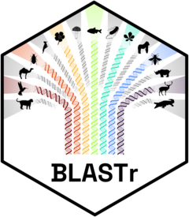

```{r}
#| label: setup-chunk
#| include: false
knitr::opts_chunk$set(
  collapse = TRUE,
  comment = "#>",
  fig.path = "man/figures/README-",
  out.width = "100%"
)
```

# BLASTr: Parallel Taxonomic Classification of Metabarcoding Sequences <a href="https://heronoh.github.io/BLASTr/"></a>

<!-- README.md is generated from README.Rmd. Please edit that file -->

<!-- badges: start -->
[](https://github.com/heronoh/BLASTr/actions/workflows/r-cmd-check.yaml)
<!-- [](https://CRAN.R-project.org/package=BLASTr) -->
<!-- badges: end -->

## Overview

`BLASTr` is an R package that seamlessly integrates BLAST+ searches into your R workflow.
It is specifically designed for the analysis of amplicon sequences from metabarcoding and metagenomic studies.
With `BLASTr`, you can efficiently perform taxonomic classification of your sequences by leveraging the power of parallel processing and automated dependency management.

## Features

- **Parallel BLAST Searches:** Sequences are searched in batches, with the number of processes and threads chosen from your cores, RAM and database size. Searches can run in the background, with progress and ETA.
- **Automated Dependency Management:** `BLASTr` automatically installs and manages BLAST+ and Entrez Direct dependencies using `condathis`, ensuring a hassle-free setup.
- **Taxonomic Classification:** Retrieve detailed taxonomic information for your sequences using their NCBI Taxonomy IDs.
- **Flexible and Easy to Use:** The package provides a set of intuitive functions that simplify the process of running thousands of BLAST searches and handling the results.
- **Reproducible Research:** By managing dependencies in isolated Conda environments, `BLASTr` helps ensure that your analyses are reproducible.

## Installation

You can install the development version of `BLASTr` from GitHub with:

```{r}
#| label: install-instructions
#| eval: false
# install.packages("devtools")
devtools::install_github("heronoh/BLASTr")
```

## Basic Usage

Here's a simple example of how to use `BLASTr` to perform a BLAST search and retrieve taxonomic information:

```{r}
#| label: setup-blastr
#| eval: false
#| include: false
# Make sure that environments are installed in a temporary directory
withr::local_envvar(
  .new = list(
    `R_USER_DATA_DIR` = fs::path_temp("home", "data")
  )
)

# Create conda environment and install dependencies
BLASTr::install_dependencies(verbose = "silent", force = FALSE)
```

## Obtain NCBI databases

To obtain complet NCBI blast formated databases, procees as follows
```{bash}
#| eval: false

#suggestion: use screen or tmux to emulate a terminal. The downloads usually takes long.
#          tmux: https://tmuxcheatsheet.com/
#          screen: https://kapeli.com/cheat_sheets/screen.docset/Contents/Resources/Documents/index

# download volumes and md5 check files 
seq -w 000 150 | parallel wget https://ftp.ncbi.nlm.nih.gov/blast/db/nt.{}.tar.gz -t 0 --show-progress;
seq -w 000 150 | parallel wget https://ftp.ncbi.nlm.nih.gov/blast/db/nt.{}.tar.gz.md5 -t 0 --show-progress;
wget https://ftp.ncbi.nlm.nih.gov/blast/db/taxdb.tar.gz -t 0 --show-progress;
wget https://ftp.ncbi.nlm.nih.gov/blast/db/taxdb.tar.gz.md5 -t 0 --show-progress;
wget https://ftp.ncbi.nlm.nih.gov/blast/db/taxdb-metadata.json -t 0 --show-progress;
     # where 000 is the first volume and 150, the last (up to now).
     
ls *5 | parallel md5sum -c {} >> check.txt
sort check.txt > check_sort.txt

ls *tar.gz | parallel tar -xvzf {} 


  

```

## Making local custom databeses

You can turn any _.fasta_ file with unique headers into a BLAST+ formated database using the _*BLASTr*_ function _make_blast_db_. It is recomended that the unique identifier of each sequence do not contain *.*. You may provide a _.txt_ with the same name as the DB's _.fasta_ file, formated _lcl|_<SequenceId> <TaxonomyId><newline>.

If you want to retrieve _subject Scientific name_  on the results, you can download and extract the *taxdb* files from NCBI, as mentioned above. 

```{r}
#| label: make-blast-db
#| eval: false
library(BLASTr)

# First, make sure you have the necessary dependencies installed
install_dependencies()

# A vector of query sequences
seqs <- c(
  "CTAGCCATAAACTTAAATGAAGCTATACTAAACTCGTTCGCCAGAGTACTACAAGCGAAAGCTTAAAACTCATAGGACTTGGCGGTGTTTCAGACCCAC",
  "CTAGCCATAAACTTAAATGAAGCTATACTAAACTCGTTCGCCAGAGTACTACAAGTGAAAGCTTAAAACTCATAGGACTTGGCGGTGTTTCAGACCCAC",
  "GCCAAATTTGTGTTTTGTCCTTCGTTTTTAGTTAATTGTTACTGGCAAATGACTAACGACAAATGATAAATTACTAATAC",
  "AACATTGTATTTTGTCTTTGGGGCCTGGGCAGGTGCAGTAGGAACTTCACTTAGAATAATTATTCGTACTGAGCTTGGGCATCCAGGAAGACTTATCGGGGATGATCAAATCTATAATGTAATTGTTACAGCACATGCATTTGTGATAATTTTTTTTATAGTAATACCTATTATGATT",
  "ACTATACCTATTATTCGGCGCATGAGCTGGAGTCCTAGGCACAGCTCTAAGCCTCCTTATTCGAGCCGAGCTGGGCCAGCCAGGCAACCTTCTAGGTAACGACCACATCTACAACGTTATCGTCACAGCCCATGCATTTGTAATAATCTTCTTCATAGTAATACCCATCATAATCGGAGGCTTTGGCAACTGACTAGTTCCCCTAATAATCGGTGCCCCCGATATG",
  "TTAGCCATAAACATAAAAGTTCACATAACAAGAACTTTTGCCCGAGAACTACTAGCAACAGCTTAAAACTCAAAGGACTTGGCGGTGCTTTATATCCAC"
)

# Path to your local FASTA database
fasta_path <- fs::path_package("BLASTr", "extdata", "minimal_db_blast", ext = "fasta")
# Path to database
db_path <- fs::path_temp("minimal_db_blast")

# To add taxids, pass `taxid_map`: a .txt file with the same name and
#  directory as the FASTA, with two columns separated by a space. The 1st is
#  the unique ID (first word of the header, no "."), preceded by "lcl|";
#  the 2nd is the taxID.

make_blast_db(
  fasta_path = fasta_path,
  db_path = db_path,
  db_type = "nucl"
)

head(readLines(fasta_path))

file.exists(paste0(db_path, ".ndb"))

# For `ssciname` (subject scientific name) to work, BLAST must find the
#  taxdb files: export BLASTDB pointing to their directory, e.g.
#  export BLASTDB=/data/databases/core_nt:$BLASTDB
```

```{r}
#| label: blastr-parallel-blast
#| eval: false
# Run BLAST in parallel
blast_results <- parallel_blast(
  query_seqs = seqs,
  db_path = db_path,
  total_cores = 2 # Total number of threads to use
)

blast_results
```

### How the search is split

`parallel_blast()` groups the sequences in batches and runs one `blastn` per batch, so the database is read once per batch instead of once per sequence.
How many `blastn` run at once, with how many threads each, and how many sequences go in each batch are chosen automatically from `total_cores`, `ram_gb` (the RAM available for the search; the total RAM of the machine by default), the size of the database(s) and the number of sequences.
`blast_strategy()` shows the plan without running BLAST:

```{r}
#| label: blastr-strategy
#| eval: false
blast_strategy(
  n_seqs = 2000,
  db_path = "/data/databases/core_nt/core_nt",
  total_cores = 32,
  ram_gb = 256
)
```

`num_threads`, `batch_size` and `mt_mode` override the automatic choice.
Several databases can be given as a vector in `db_path`; they are searched together, smallest first.

While BLAST runs, a progress bar shows the percentage done and the estimated time left (ETA).

### Running in the background

With `background = TRUE`, `parallel_blast()` starts the search in a separate process and returns a job at once, so the R session (or a pipeline run in blocks) is free in the meantime.
The job lives in a directory and survives the end of the R session.

```{r}
#| label: blastr-background
#| eval: false
job <- parallel_blast(
  query_seqs = seqs,
  db_path = db_path,
  total_cores = 2,
  background = TRUE
)

blast_job_status(job) # progress and ETA
blast_results <- blast_job_result(job) # waits for the end if needed

# From another R session:
# job <- blast_job("<job directory>")
# blast_job_cancel(job); blast_job_resume(job)
```

### Results

Each row is a query sequence.
After `Sequence`, a summary of its hits:

- `Check ID`: `"best ID"` when the best hits (the first `check_n = 3`) agree on the taxid, `"check ID"` when they do not.
  Only hits within `check_tolerance = 0.5` identity points of the best one are compared, since a clearly less identical hit is most likely another taxon. Hits with unknown taxid (`0`) never confirm an identification.
- `N hits`, `N taxids`, `N hits same taxid as 1st` and `N taxids at best identity`.

Then the hits (10 by default, `num_alignments`), each with `k_subject header`, `k_Similarity score` (`(10 * identity + qcovhsp) / 11`), `k_subject`, `k_identity`, `k_length`, `k_mismatches`, `k_gaps`, `k_query start`, `k_query end`, `k_subject start`, `k_subject end`, `k_e-value`, `k_bitscore`, `k_qcovhsp` and `k_staxid`, where `k` is the hit rank.

BLASTr keeps track of any errors that may occur during the BLAST searches. You can retrieve the exit codes and STDERR messages using the `exit_codes()` function.

```{r}
#| label: blastr-exit-codes
#| eval: false
# Check for any errors during BLAST searches
exit_code_df <- exit_codes(blast_results)
print(exit_code_df[c("exit_code", "stderr")])
```

```{r}
#| label: blastr-get-taxonomy
#| eval: false
# Extract the taxonomy IDs from the top BLAST hit for each query sequence.
tax_ids <- blast_results$`1_staxid`

# Retrieve taxonomic information in parallel
taxonomic_info <- parallel_get_tax(
  organisms_taxIDs = tax_ids,
  total_cores = 2,
  retry_times = 0
)

print(taxonomic_info)
```

## Main Functions

- `install_dependencies()`: Installs BLAST+ and Entrez Direct if they are not found on your system.
- `make_blast_db()`: Creates a BLAST database from a FASTA file.
- `parallel_blast()`: Runs BLAST searches for multiple sequences in parallel, in the foreground or in the background.
- `parallel_blast_hsps()`: Like `parallel_blast()`, but returns every HSP in long format, against a database or a FASTA file (`subject`).
- `blast_log_path()`, `read_blast_log()`: Optional log of the searches (`log_dir`).
- `blast_strategy()`: Shows how `parallel_blast()` will split a search.
- `blast_job_status()`, `blast_job_result()`, `blast_job_cancel()`, `blast_job_resume()`: Follow a search running in the background.
- `check_hits()`, `similarity_score()`: Hit agreement (`Check ID`) and Similarity score.
- `exit_codes()`: Retrieve the exit codes and STDERR messages from BLAST searches.
- `parallel_get_tax()`: Retrieves taxonomic information for multiple NCBI Taxonomy IDs in parallel.
- `run_blast()`: A lower-level function to run a BLAST search and return the raw output.
- `parse_fasta()`: Extracts sequences from a FASTA file.
- `get_fasta_header()`: Retrieves the full header of a sequence from a BLAST database.

## Dependency Management

`BLASTr` uses the `condathis` package to manage its dependencies (BLAST+ and Entrez Direct).
When you run a function that requires one of these tools, `BLASTr` will automatically check if it's installed.
If not, it will create a Conda environment and install the necessary software.
This ensures that you always have the correct versions of the dependencies without having to install them manually.

You can control the installation process with the `force` and `verbose` arguments in the `install_dependencies()` function.

## Contributing

Contributions are welcome! Please see the [contributing guide](./.github/CONTRIBUTING.md) for more details.

## License

This project is licensed under the MIT License - see the [LICENSE.md](./LICENSE.md) file for details.
